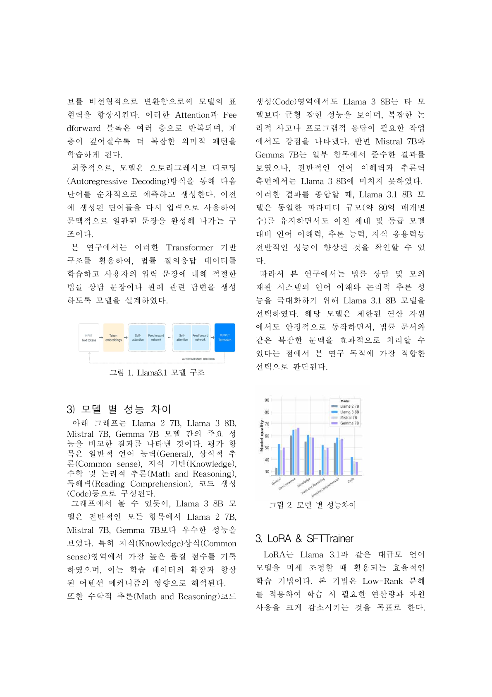
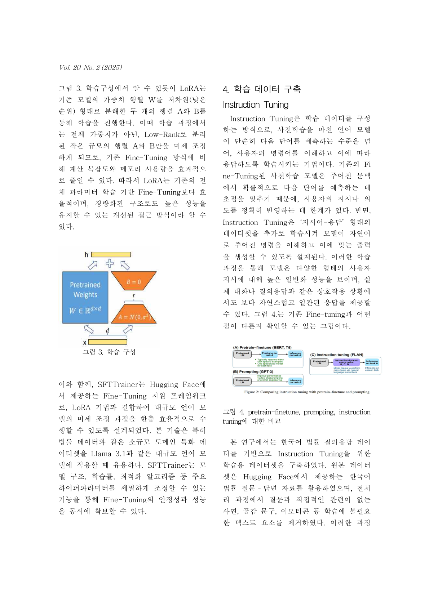

# 법률상담 AI (The Legal Consultation AI)

Llama 3.1 8B를 LoRA로 파인튜닝해서 만든 법률상담 AI입니다. 대구대학교 5인 팀
(김지환, 김두한, **김민석**, 신영훈, 김희철) 졸업작품이고, 대구대학교 공학제에서
**최우수상**을 받았습니다.

변호사 상담이 30분에 5~10만 원, 사건을 맡기면 최소 100만 원대가 드는 걸 보고,
돈과 시간 부담 없이 1차 자문 정도는 받을 수 있는 시스템을 만들어보자고
시작했습니다.

## 모델 구조



Transformer 기반 LLM으로, 토큰화 → 임베딩 → Self-Attention → Feedforward →
Autoregressive Decoding 순서로 동작합니다. Llama 2 7B, Mistral 7B, Gemma 7B와
직접 비교해봤는데(위 이미지 오른쪽 그래프), Llama 3 8B가 지식·상식·추론 전
영역에서 가장 균형 잡혀서 베이스 모델로 골랐습니다.

## LoRA 파인튜닝



전체 가중치를 다 학습하는 대신 저차원 행렬 A·B만 학습하는 LoRA를 썼습니다.
계산량과 메모리를 크게 줄일 수 있었고요. 아래는 실제 학습 코드
(`법률_데이터셋_학습.ipynb`)에서 핵심만 뽑은 부분입니다.

```python
# 📌 2. Huggingface 로그인
from huggingface_hub import notebook_login
notebook_login()

# 📌 3. 모델 로드 (Unsloth 기반)
from unsloth import FastLanguageModel
model, tokenizer = FastLanguageModel.from_pretrained(
    model_name = "unsloth/Meta-Llama-3.1-8B-Instruct-bnb-4bit",  # 4bit 모델
    max_seq_length = 2048,
    dtype = None,
    load_in_4bit = True,
)

# 📌 4. 데이터셋 로드
from datasets import load_dataset
dataset = load_dataset("kms7529/Law_dataset", split="train")

def formatting_func(example):
    instruction = example.get("instruction", "")
    input_text = example.get("input", "")
    output_text = example.get("output", "")
    prompt = f"### Instruction:\n{instruction}\n\n### Input:\n{input_text}\n\n### Response:\n{output_text}"
    return {"text": prompt}

dataset = dataset.map(formatting_func)

# 📌 6. LoRA 적용
model = FastLanguageModel.get_peft_model(
    model,
    r=16,
    lora_alpha=16,
    lora_dropout=0.05,     # Dropout 추가 (Overfitting 방지)
    target_modules=["q_proj", "v_proj"],
    use_rslora=False,
    bias="none",
)

# 📌 7. Trainer 설정 (A100 최적화)
from transformers import Trainer, TrainingArguments

training_args = TrainingArguments(
    output_dir="./llama3-law-finetune5",
    per_device_train_batch_size=8,
    gradient_accumulation_steps=4,
    num_train_epochs=1,
    learning_rate=1.5e-5,
    bf16=True,
    optim="paged_adamw_8bit",
)

trainer = Trainer(model=model, train_dataset=dataset, args=training_args, ...)
trainer.train()
```

실제 학습 로그(A100, 53,480 샘플, 1 epoch = 1,671 step):

```
Num examples = 53,480 | Num Epochs = 1 | Total steps = 1,671
Batch size per device = 8 | Gradient accumulation steps = 4
Trainable parameters = 6,815,744 / 8,000,000,000 (0.09% trained)
...
TrainOutput(global_step=1671, training_loss=1.754338427120736,
            metrics={'train_runtime': 7248.8403, 'train_loss': 1.754338427120736})
```

## Epoch 스윕 — 왜 2 epoch인가

| 실험 | 결과 |
|---|---|
| Epoch 1 | 학습 부족, 응답 일관성 낮음 |
| **Epoch 2** | **채택 — 가장 안정적이고 명확한 출력** |
| Epoch 3 | 과적합, 일부 응답 불안정 |

학습률은 5e-5에서 점점 낮추는 스케줄을 썼고, 1.5e-5~2e-5 구간에서 제일
안정적으로 수렴했습니다.

## 문장 정제 후처리

작은 모델에서 자주 나오는 문제들 — 같은 구절 반복, 문장이 끝맺음 없이
끊기는 것 — 을 `difflib.SequenceMatcher`로 후처리했습니다. 실제 배포 코드
(`법률상담사이트_최종.ipynb`)에 있는 함수들입니다.

```python
from difflib import SequenceMatcher
import re

def is_similar(a, b, threshold=0.85):
    return SequenceMatcher(None, a, b).ratio() > threshold

def clean_sentence(sentence):
    sentence = sentence.strip()
    sentence = re.sub(r'(\b\w+\b)(\s*에 대한\s*\1)+', r'\1', sentence)
    sentence = re.sub(r'\b(\w+)\s+\1\b', r'\1', sentence)
    if len(sentence) < 6 or sentence.endswith(("의", "에", "는", "은", "가", "로", "과", ",")):
        return None
    return sentence

def format_sentences_with_linebreaks(text):
    text = re.sub(r'\s+', ' ', text.strip())
    sentences = re.split(r'(?<=[.!?])\s+', text)
    cleaned_sentences = []
    for s in sentences:
        cleaned = clean_sentence(s)
        if cleaned and not any(is_similar(cleaned, c) for c in cleaned_sentences):
            cleaned_sentences.append(cleaned)
    return "\n".join(cleaned_sentences)

def truncate_incomplete_sentences(text):
    # 문장이 마침표 없이 끊기면, 마지막 완결된 문장까지만 자른다
    if not re.search(r'[.!?]"?$', text.strip()):
        last_period = text.strip().rfind(".")
        if last_period != -1:
            return text[:last_period + 1]
    return text
```

## Gradio 배포

```python
def law_consultation_gpt(user_message, chat_history):
    prompt = f"[사용자]: {user_message}\n[AI 법률상담사]:"
    inputs = tokenizer(prompt, return_tensors="pt").to("cuda")
    outputs = model.generate(
        **inputs, max_new_tokens=800,
        temperature=0.7, top_p=0.9, repetition_penalty=1.05
    )
    response = tokenizer.decode(outputs[0], skip_special_tokens=True)
    response = response.split("[AI 법률상담사]:")[-1].strip()
    response = truncate_incomplete_sentences(response)
    response = format_sentences_with_linebreaks(response)
    chat_history = (chat_history or []) + [(user_message, response)]
    return chat_history, chat_history

with gr.Blocks(theme=gr.themes.Soft()) as demo:
    ...
    submit_btn.click(fn=law_consultation_gpt, inputs=[user_input, chat_history], outputs=[chat_history, chat_history])

demo.launch(share=True)
```

Colab에서 학습하고, LoRA 어댑터를 Google Drive에 올린 다음, 별도 노트북에서
그 어댑터를 불러와 Gradio로 서빙하는 흐름으로 배포했습니다 (`사용설명서.txt`에
순서를 정리해뒀습니다).

## 파일

| 파일 | 내용 |
|---|---|
| [`법률_데이터셋_학습.ipynb`](법률_데이터셋_학습.ipynb) | 데이터셋 정제 + LoRA/SFTTrainer 학습 코드 (Google Colab) |
| [`법률상담사이트_최종.ipynb`](법률상담사이트_최종.ipynb) | Gradio 기반 법률 상담 웹 인터페이스 코드 |
| [`졸업작품 최종 보고서.hwp`](졸업작품%20최종%20보고서.hwp) | 졸업작품 최종 보고서 |
| [`법률상담 ai 최종보고서.pptx`](법률상담%20ai%20최종보고서.pptx) | 발표자료 (공학제 제출용) |
| [`법률상담 ai 논문 초안.pdf`](법률상담%20ai%20논문%20초안.pdf) | 논문 초안 — **학술지 게재 여부는 확인되지 않음** |
| [`사용설명서.txt`](사용설명서.txt) | 학습 → 배포까지 실행 순서 |
| [`dataset_sample_40rows.jsonl`](dataset_sample_40rows.jsonl) | 학습 데이터셋 샘플 40행 (전체 56,358행 중 일부) |
| [`model-adapter-config/`](model-adapter-config) | 학습된 LoRA 어댑터의 설정 파일 |
| [`images/`](images) | 논문 PDF 페이지 전체(`page-01`~`07`) + UI 목업 |

## 한계 (논문에서 직접 밝힌 내용)

8B 모델에 5만여 건 데이터로는 상용 대형 챗봇만큼 문장이 매끄럽진 않고,
학습 데이터가 민사법 위주라 형사·행정·가사는 다루지 못합니다. 결과는
참고용이고, 실제 법적 판단이나 소송 대리를 대신할 수 없습니다.

## 용량 문제로 전체를 올리지 않은 것

- **학습 데이터셋 전체** (`reformatted_law_dataset_cleaned_final.jsonl`, 약 75MB,
  56,358행) — 대신 위 40행 샘플만 올렸습니다. 원본은 Hugging Face에 공개된
  한국어 법률 질문-답변 코퍼스를 정제해서 만들었습니다.
- **학습된 LoRA 가중치** (`adapter_model.safetensors`, 약 27MB)와
  **토크나이저 전체 파일**(`tokenizer.json`, 약 16MB)은 빼고,
  `model-adapter-config/`에 `adapter_config.json`(LoRA rank/alpha 등
  하이퍼파라미터), `tokenizer_config.json`, `special_tokens_map.json`만
  넣어뒀습니다.

## 공동 저자

김지환, 김두한, **김민석**, 신영훈 — 대구대학교 4인 팀 프로젝트.
